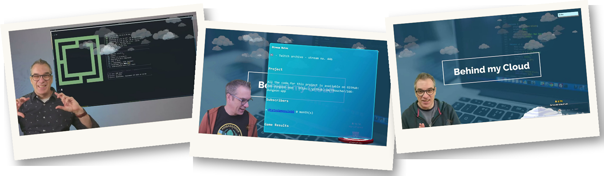

# Stream Projects

This repository the backend of the website **[Beyond My Cloud](https://behindmycloud.com/)**. The goal is to keep tracks of all work done on the stream on [Twitch](https://www.twitch.tv/fboucheros) and [YouTube](https://www.youtube.com/@behindmycloud). On the websiteis updated the next day and contains the complete list of the streams, the stream notes, all code and the videos references.

# Projects examples

Here some of the projects we worked on but there so many more!

## [AzUrlShortener](https://github.com/FBoucher/AzUrlShortener)

An simple and easy budget friendly Url Shortener for anyone. It runs in Azure (Microsoft cloud) in your subscription.

🔗 [https://github.com/FBoucher/AzUrlShortener](https://github.com/FBoucher/AzUrlShortener)

---

## [2D6 Dungeon App](https://github.com/FBoucher/2d6-dungeon-app)

Digital adaptation of 2D6 Dungeon, a classic style dungeon crawler, print and play. This is a web app that will help you to play the game.

🔗 [https://github.com/FBoucher/2d6-dungeon-app](https://github.com/FBoucher/2d6-dungeon-app)

---

## [Note Bookmark](https://github.com/FBoucher/NoteBookmark)

Web App to collect thoughts about articles, and blob posts read and then aggregate them in a Reading Notes blog post.

🔗 [https://github.com/FBoucher/NoteBookmark](https://github.com/FBoucher/NoteBookmark)

---

## [Blind2021 (aka Project Dover)](https://github.com/FBoucher/ProjectDover)

Text-based adventure game, in a near future where you and your glasses companion are exploring your environment. Base on the ProjectDover.  Using AI to simplify commands ( talk humans AI translate to game commands) 

🔗 [https://github.com/FBoucher/ProjectDover](https://github.com/FBoucher/ProjectDover)

---

## [Use-R-Vote (aka outspoken)](https://github.com/FBoucher/use-r-vote)

An online request/idea voting platform manage by the community. You pitch your idea the community vote on it. The most popular get picked.

🔗 [https://github.com/FBoucher/use-r-vote](https://github.com/FBoucher/use-r-vote)

---

## [Azure Subscription Cleaner (AzSubscriptionCleaner)](https://github.com/FBoucher/AzSubscriptionCleaner)

Azure Subscription Cleaner is a simple tool that will automatically delete "expired" resources inside our Azure Subscription.

🔗 [https://github.com/FBoucher/AzSubscriptionCleaner](https://github.com/FBoucher/AzSubscriptionCleaner)

---

## [Not a Dog Workshop](https://github.com/FBoucher/Not-a-Dog-Workshop)

A workshop 1 hour workshop to update a website using Cognitive services and Azure Function.

🔗 [https://github.com/FBoucher/Not-a-Dog-Workshop](https://github.com/FBoucher/Not-a-Dog-Workshop)

---

## [Azure Unzip Everything](https://github.com/FBoucher/AzUnzipEverything)

A simple Azure Function to Unzip files from a blob storage to another one 

🔗 [https://github.com/FBoucher/AzUnzipEverything](https://github.com/FBoucher/AzUnzipEverything)

---
